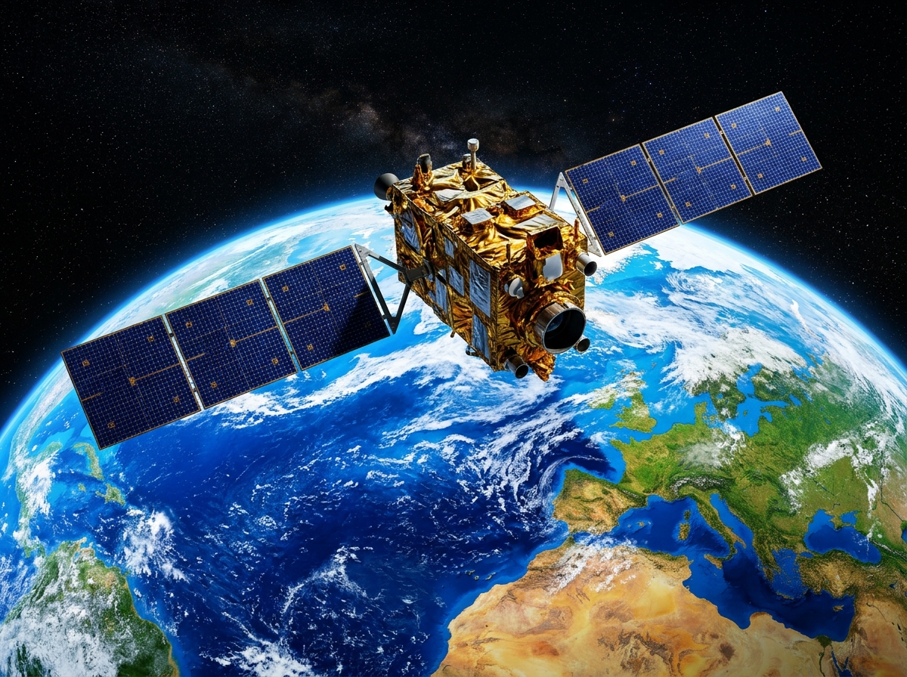
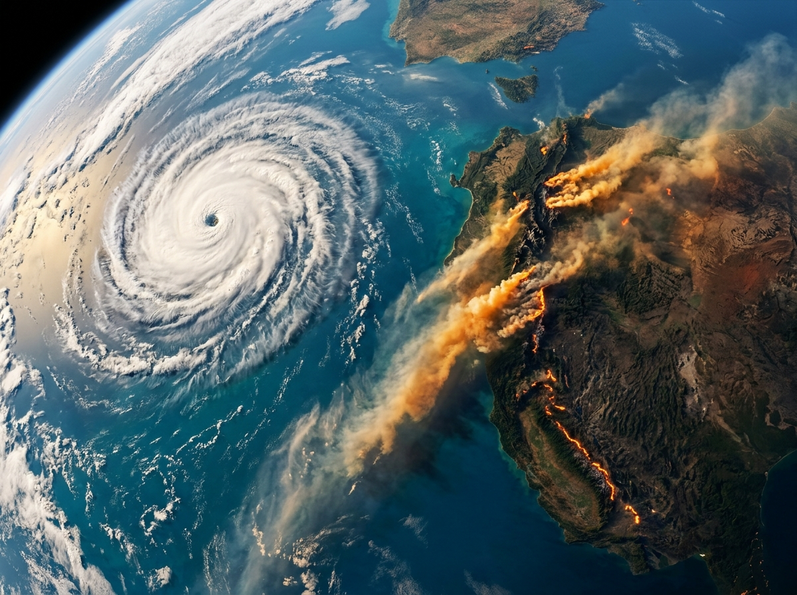
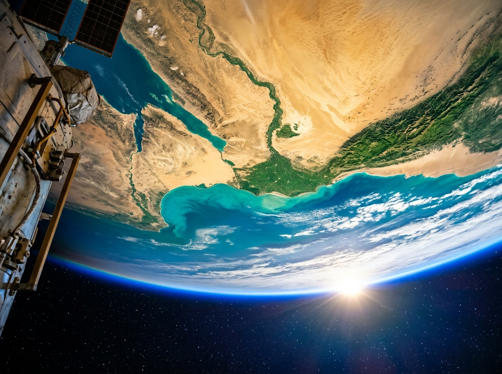

<div align="center">


# 🌍 Orbisys
### **Planetary Intelligence & Real-Time Earth System Observability**

[](LICENSE)
[](https://react.dev/)
[](https://www.typescriptlang.org/)
[](https://vitejs.dev/)
[](https://tailwindcss.com/)
[](https://d3js.org/)
[](https://eonet.gsfc.nasa.gov/)
[](https://ai.google.dev/)

<p align="center">
  <b>Decode Earth’s vital signs in real time.</b> Orbisys transforms raw telemetry from NASA's Earth Observatory Natural Event Tracker (EONET v3) and orbital remote-sensing constellations into actionable environmental trend intelligence, interactive 3D visualizations, and autonomous synthesis dossiers.
</p>

---

</div>

## 📌 Overview

**Orbisys** bridges the gap between raw aerospace telemetry and immediate decision-making. Climate disturbances, extreme weather events, volcanic eruptions, and cryospheric anomalies happen continuously across the globe. Traditional earth science portals present this data as disconnected tabular feeds or static maps.

Orbisys delivers an interactive, high-fidelity operations console featuring:
- **Interactive D3.js 3D Wireframe Globe**: Dynamic orthographic projection with smooth spherical interpolation (`flyTo`), coordinate projection, and pulsing anomaly pins.
- **Real-Time NASA EONET v3 Integration**: Live ingestion of open planetary events across dynamic 7-day, 30-day, and 90-day orbital monitoring windows.
- **Orbital Trend Synthesis Dossiers**: Autonomous anomaly analysis evaluating persistence indices, spread momentum, and aerosol risk classifications.
- **Constellation Telemetry & Pass Tracking**: Dedicated mission tracking across NASA Terra, Aqua, Suomi NPP, NOAA-20, Landsat 8/9, Sentinel-2, and Sentinel-3.
- **Direct NASA Worldview Uplink**: Deep-linking directly into NASA Worldview for immediate multi-spectral true-color and thermal satellite imagery inspection.

---

## 📸 System Architecture & Visuals

| 01. Ingestion Pipeline | 02. Neural Detection | 03. Orbital Synthesis |
| :---: | :---: | :---: |
|  |  |  |
| *NASA EONET v3 & Constellation Ingest* | *Real-time Spatial & Coordinate Mapping* | *Automated Dossier & Anomaly Intelligence* |

---

## ⚡ Key Features

### 🌐 1. High-Performance 3D Dotted Canvas Globe
- Built using **D3.js (`d3-geo`, `d3-interpolate`)** rendering to an optimized HTML5 Canvas.
- Real-time drag-to-rotate, auto-spin idle states, and coordinate-targeted fly-to animations with shortest-arc spherical quaternion calculations.
- Live spatial projection of geo-coordinates with real-time occluded-hemisphere clipping.

### 🛰️ 2. Comprehensive Anomaly Classification
Multi-hazard intelligence tracking across critical planetary categories:
- 🔥 **Wildfires** (`#F97316`): MODIS/VIIRS thermal hotspot clustering, fire radiative power (MW), and aerosol dispersion risk.
- 🌀 **Severe Storms** (`#3B82F6`): Tropical cyclones, hurricanes, typhoons, wind speed tracking (knots), and central barometric pressure.
- 🌋 **Volcanoes** (`#EF4444`): Volcanic ash plumes, seismic activity signatures, and SO₂ emission profiles.
- 🧊 **Sea & Lake Ice** (`#06B6D4`): Polar ice calving, pack ice displacement, and seasonal cryospheric coverage changes.

### 📊 3. Trend Analytics & Orbital Dossiers
- **Dynamic Dossier Synthesis**: Calculates persistence scores based on historical geometric observations, telemetry duration, and observational intervals.
- **Aerosol & Spread Risk Modeling**: Heuristic severity scoring generating actionable impact assessments.
- **Trend Sparklines**: Inline SVG rendering visualizing multi-epoch event evolution and observation cadence over time.
- **Constellation Telemetry**: Sensor suites (MODIS, VIIRS, OLI, TIRS, MSI, OLCI, SLSTR) paired with orbit specifications (SSO 705 km, 824 km).

### ⚡ 4. Offline Resilience & Fallback Data Layer
- Built-in graceful degradation: when the NASA EONET endpoint is unreachable or throttled, Orbisys seamlessly activates an enriched offline reference dataset to ensure continuous operational uptime.

---

## 🛠️ Tech Stack

| Layer | Technology |
| :--- | :--- |
| **Frontend Framework** | [React 19](https://react.dev/) + [TypeScript](https://www.typescriptlang.org/) |
| **Build Tool & Bundler**| [Vite 8](https://vitejs.dev/) |
| **Styling & Design System** | [Tailwind CSS v4](https://tailwindcss.com/) + Custom Glassmorphism Theme |
| **Geospatial & Visualization** | [D3.js v7](https://d3js.org/) (`d3-geo`, `d3-selection`, `d3-interpolate`) + HTML5 Canvas |
| **Motion & Animation** | [Motion (Framer Motion)](https://motion.dev/) + [tw-animate-css](https://www.npmjs.com/package/tw-animate-css) |
| **Icons** | [Lucide React](https://lucide.dev/) |
| **AI Integration** | [@google/genai](https://www.npmjs.com/package/@google/genai) (Google GenAI SDK) |
| **Data Source** | [NASA Earth Observatory Natural Event Tracker (EONET v3 REST API)](https://eonet.gsfc.nasa.gov/docs/v3) |

---

## 📁 Project Structure

```bash
Orbisys/
├── components/
│   └── ui/
│       └── wireframe-dotted-globe.tsx      # D3-powered canvas 3D interactive globe
├── src/
│   ├── assets/
│   │   └── images/
│   │       ├── Orbisys Banner.png          # Primary project banner
│   │       ├── orbisys_planet_detect_*.jpg # Anomaly detection visual
│   │       ├── orbisys_planet_ingest_*.jpg # Pipeline ingestion visual
│   │       └── orbisys_planet_synthesize_* # Trend synthesis visual
│   ├── components/
│   │   └── dashboard/
│   │       ├── EventFeedSidebar.tsx        # Filterable live satellite event stream
│   │       ├── SecondaryTabs.tsx           # Trend Analytics & Satellites constellation views
│   │       ├── TrendDossierSidebar.tsx     # Orbital synthesis & anomaly intelligence panel
│   │       └── TrendSparkline.tsx          # Real-time SVG observation sparklines
│   ├── utils/
│   │   ├── eonet.ts                        # NASA EONET API normalizer, analytics & math
│   │   └── eonet.test.ts                   # Unit & integration test suite
│   ├── App.tsx                             # Core application shell & routing orchestrator
│   ├── index.css                           # Tailwind CSS v4 styling & custom scrollbars
│   └── main.tsx                            # React DOM entry point
├── index.html                              # High-end cinematic landing page & video canvas
├── vite.config.ts                          # Vite build configuration & path alias resolvers
├── tsconfig.json                           # TypeScript strict mode configuration
└── package.json                            # Project dependencies and script declarations
```

---

## 🚀 Getting Started

### Prerequisites

Ensure you have the following installed:
- [Node.js](https://nodejs.org/) (version `18.0.0` or higher)
- [npm](https://www.npmjs.com/) or [bun](https://bun.sh/)

### 1. Clone the Repository

```bash
git clone https://github.com/your-username/Orbisys.git
cd Orbisys
```

### 2. Install Dependencies

```bash
npm install
# or
bun install
```

### 3. Configure Environment Variables

Create a `.env.local` file in the root directory (refer to [.env.example](.env.example)):

```env
# Gemini API Key (Required for AI Studio & Gemini GenAI features)
GEMINI_API_KEY="your-gemini-api-key-here"

# Application URL
APP_URL="http://localhost:3000"
```

> 💡 *Note: You can acquire an API key from Google AI Studio at [aistudio.google.com](https://aistudio.google.com/).*

### 4. Run the Development Server

```bash
npm run dev
# or
bun run dev
```

Open your browser and navigate to:
- **Landing Experience**: `http://localhost:3000/`
- **Operations Console**: `http://localhost:3000/dashboard`

---

## 🧪 Available Scripts

| Command | Action |
| :--- | :--- |
| `npm run dev` | Starts the Vite development server on port 3000 (`0.0.0.0`) |
| `npm run build` | Builds the optimized production bundle to the `dist/` directory |
| `npm run preview` | Previews the production build locally |
| `npm run lint` | Runs TypeScript type checking without emitting files (`tsc --noEmit`) |
| `npm run clean` | Cleans up previous build artifacts |

---

## 🛰️ Data Sources & Attributions

- **NASA EONET**: Planetary anomaly events provided by the [NASA Earth Observatory Natural Event Tracker (v3)](https://eonet.gsfc.nasa.gov/).
- **NASA Worldview & GIBS**: Direct imagery resolution powered by NASA's [Global Imagery Browse Services (GIBS)](https://www.earthdata.nasa.gov/eosdis/science-system-description/eosdis-components/gibs).
- **Satellite Constellations**: Telemetry reference data for NASA Terra, Aqua, Suomi NPP, NOAA-20, Landsat 8/9, and ESA Copernicus Sentinel-2/3.

---

## 📜 License

This project is licensed under the **MIT License** — see the [LICENSE](LICENSE) file for complete details.

Copyright (c) 2026 Muhammad Minhal.

<div align="center">
  <sub>Built with ❤️ for real-time Earth science, climate observation, and open planetary intelligence.</sub>
</div>
